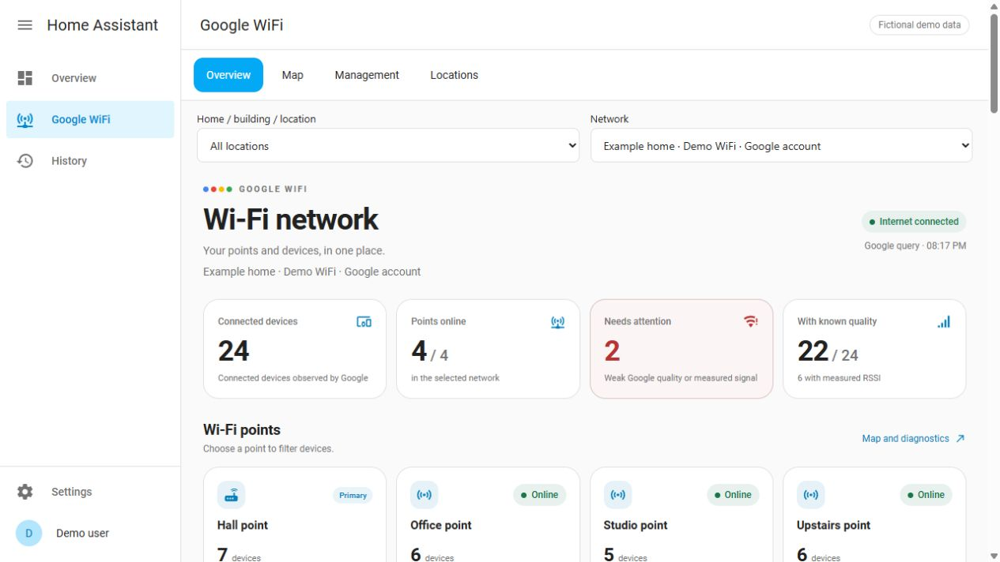
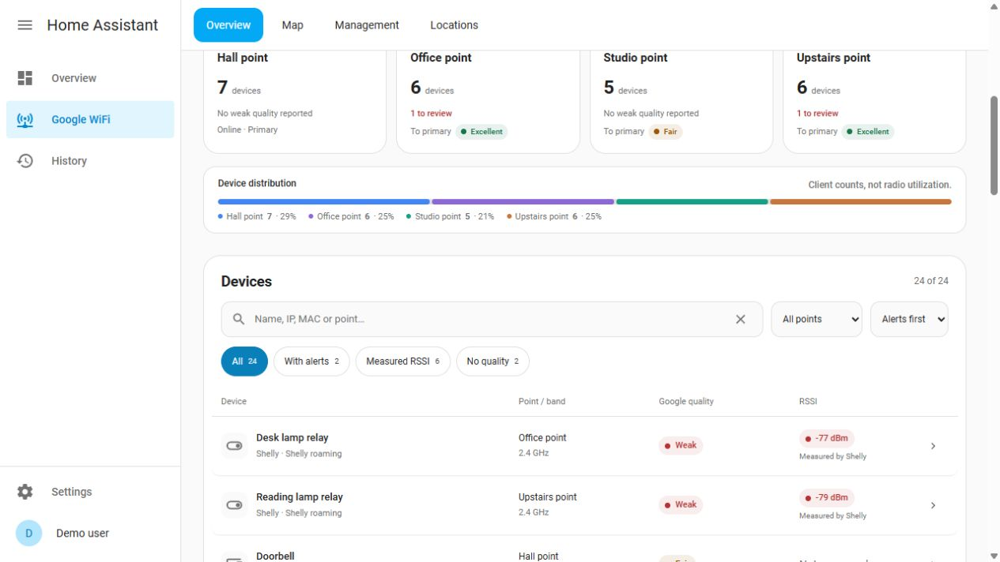
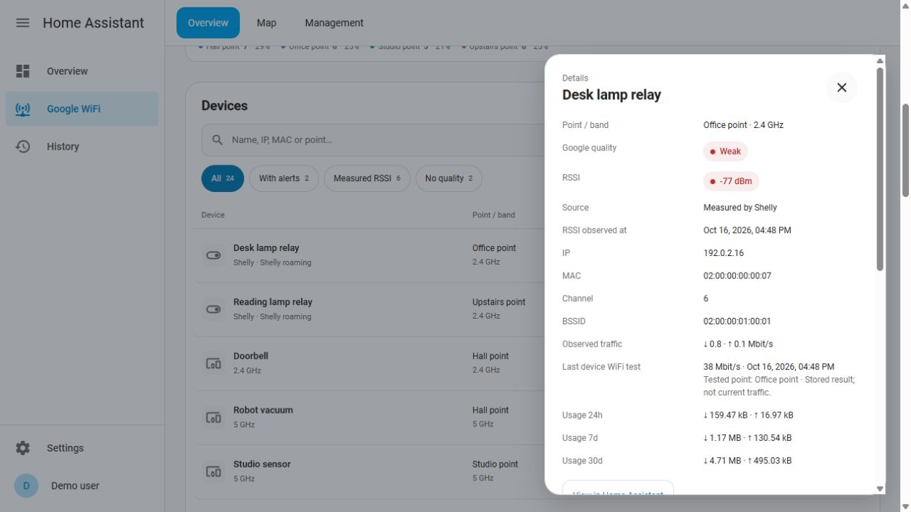
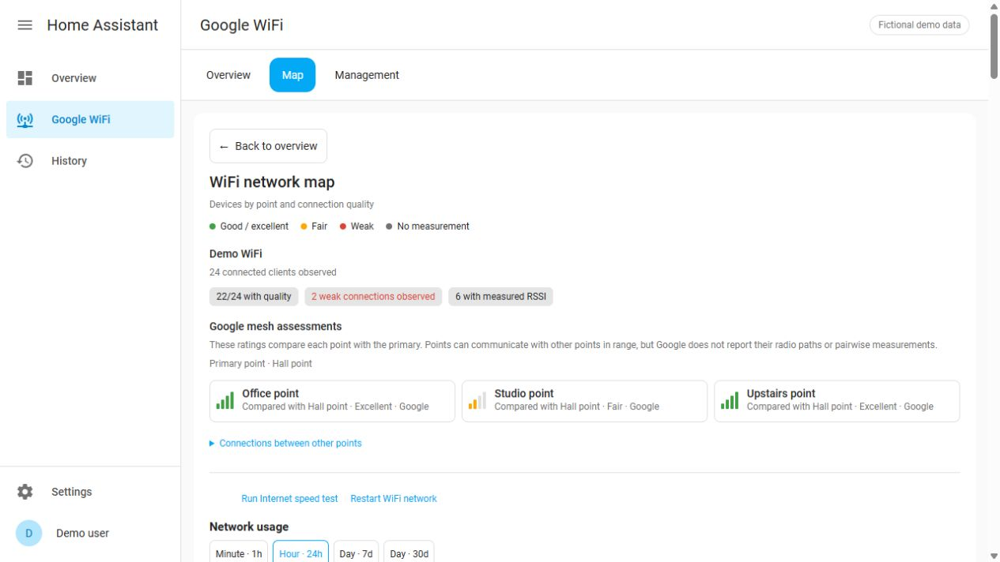
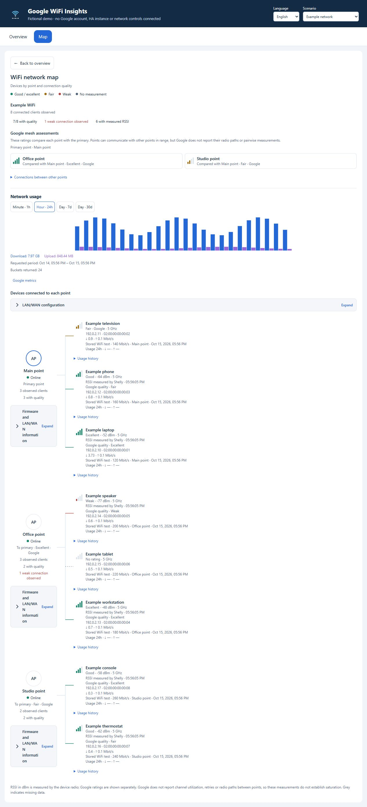
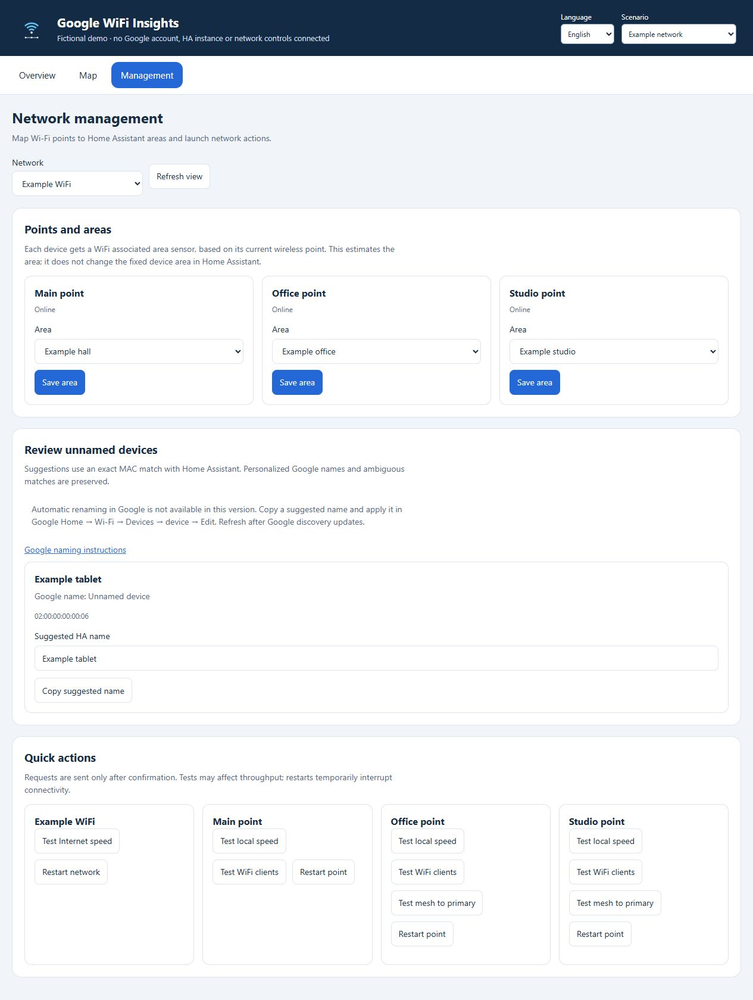

# Google WiFi Insights

Google/Nest WiFi custom integration for Home Assistant: network overview, client
association map, usage history, available Google controls and local Shelly RSSI.
It can coexist with Home Assistant's official `google_wifi` integration.

**Beta 0.12.0.** This repository is `spkon/ha_google_wifi`. The project is public and licensed under MIT. It is an
unofficial community integration, not maintained by Google or Home Assistant.

[Support development on Buy Me a Coffee](https://buymeacoffee.com/spkon)

## Install with HACS

1. Open **HACS → menu → Custom repositories**.
2. Add `https://github.com/spkon/ha_google_wifi` as **Integration**.
3. Find **Google WiFi Insights**, download it and restart Home Assistant.
4. Open **Settings → Devices & services → Add integration → Google WiFi Insights**.
5. Choose **Google account and clients** for full network/client data, or local
   point status for firmware/uptime. Both entries can coexist.
6. After configuration, open **Google WiFi** in the sidebar. The overview and map
   are included: no separate JavaScript copy, Lovelace resource or YAML is required.
7. If the account exposes several homes, open **Locations** to label each network
   and follow its connection guide. Filter Overview, Map and Management by home
   and network. [Location setup and local/cloud differences](docs/LOCATIONS.md).

HACS custom-repository installation is separate from inclusion in its default
catalogue. Original brand assets are bundled for modern HA/HACS. Default-catalogue
inclusion remains a separate submission. See [INSTALL.md](INSTALL.md) for Google authentication,
manual installation, upgrades and troubleshooting.

## Preview



These are browser captures of the released dashboard components in a simulated
Home Assistant frame. All devices, areas, addresses and readings are fictional;
no household inventory or live-network capture is included.
[Run the local demo](docs/TESTING.md#browser-demo).

<details>
<summary>Device list, measured signal and device details</summary>





</details>

<details>
<summary>Map, client associations and Google mesh assessments</summary>





</details>

<details>
<summary>Point areas and Google name suggestions</summary>




</details>

## What you get

- Account-discovered networks, points and clients; explicit client-to-point
  association, presence, IP/MAC, band/capabilities and last-seen data when supplied.
- `Google name (Home Assistant name)` matching through exact MAC or an unambiguous
  current IP. Other integrations' device records are preserved.
- Google's connection/mesh ratings and current download/upload traffic.
- Saved WAN, client WiFi and mesh speed tests with original dates/tested points.
- Network and client usage graphs: minutes over one hour, hours over 24 hours,
  days over 7 or 30 days, with partial coverage visible and no invented zeroes.
- Point/network restarts, tests, client Internet pause/priority, point lights and
  typed administrator services for supported group/insight actions.
- MAC-verified Shelly RSSI/BSSID/channel and eligible roaming controls.
- English/Portuguese UI following Home Assistant's user language and time zone.
- Guided Google authentication, automatic Android ID for browser tokens, specific
  errors and credential renewal from the integration's options.
- Firmware release notes with explicit version matching, local update state/channel/
  raw progress and additional LAN/WAN diagnostics in HA and the map.
- Complete collected network configuration and endpoint availability, excluding
  credentials and provisioning secrets.
- Sanitized additional telemetry, capability status and explicit operation results.
- Live restart/speed-test feedback: sending, accepted, running and completed states
  reported by Google, with separate failure and unconfirmed-delivery states.

The [capability inventory](docs/CAPABILITIES.md) distinguishes implemented actions,
verified reads and configuration features whose write schemas remain unverified.
Normal polling does not run benchmarks or restart points. Destructive operations
have no buttons and require deliberate administrator confirmation.

## Point areas and network management

Open **Google WiFi → Management** to map each point to an existing Home Assistant
area. A new **WiFi associated area** sensor follows each client's current wireless
point, while its fixed HA device area stays unchanged. Mappings are stored locally
and survive integration reloads. The map shows the mapped point areas and client
area estimates. A point association estimates coverage, not physical room presence.

The same page groups confirmed-target restarts and speed tests with request
confirmation and operation status. It also proposes names for generic Google
clients using exact, unambiguous HA MAC matches. Version 0.11.0 can apply a
selected proposal, verify its result, undo it and enable automatic naming per
network. Automatic naming starts disabled. Personalized Google names are
preserved; uncertain results pause automatic writes and are never retried.

For a one-time cleanup, select device checkboxes and use **Rename selected**, or
choose **Rename all eligible**. Version 0.11.1 confirms the complete proposal list,
shows progress and stops on an unconfirmed or rejected result. It does not
enable automatic naming. Keep Management open while the batch runs; use
**Stop after current device** to stop the remaining queue.

The request schema was established by static inspection of Google's Android
client. This release has no new live Google-account trial: provider acceptance
is established only by a successful runtime read-back. See
[automatic naming](docs/NAME_SYNC.md) for provenance, limits and privacy, and
[management and associated areas](docs/MANAGEMENT.md) for point/area behavior.

## Requirements and limits

Validated with **Home Assistant 2026.10.1**, **Python 3.14** and **Node.js 24** for
development tests. HACS conservatively requires HA 2026.10.1, the version tested;
older versions and all Google/Nest models have not been validated.

Google account access uses undocumented endpoints and `gpsoauth==2.0.0`.
Authentication can change or fail. Google ratings are categories, not measured
dBm. Local mode accepts 1–10 reachable private IPv4 points. Shelly access supports
registered, MAC-matched Gen2/Gen3/Gen4 devices with authentication disabled and
compatible WiFi RPC; only roam threshold/interval are changed.

Usage windows are rolling UTC intervals, not Google Home's calendar-day totals.
Missing intervals remain unknown. Stored speed tests are not live traffic.
The observed Google endpoints do not expose BSSID pinning, radio airtime/noise/
retries or every physical mesh hop. Counts and traffic do not prove saturation.
Guest WiFi/DNS/DHCP/port-forwarding and other unverified configuration writes are
catalogued but not guessed.

Tokens stay in Home Assistant's integration configuration. Never put tokens,
personal inventories or unredacted diagnostics in this repository or its issues.

## Development and validation

```sh
python -m venv .venv
# Activate it, then:
python -m pip install -r requirements-dev.txt
python -m pytest -q
npm ci --ignore-scripts
npm test
python tools/sync_frontend.py --check
python tools/build_package.py
```

The tests use synthetic fixtures and an isolated real HA framework; they need no
Google account, LAN devices or private captures. The frontend development files
in `www/` have byte-identical bundled copies inside `custom_components`; run
`python tools/sync_frontend.py` after editing them. CI checks the copies and tests.

See [validation/audit](docs/AUDIT.md), [credits](CREDITS.md) and
[publication checklist](docs/PUBLISHING.md). Documentation, code comments and
docstrings are written in English; see [CONTRIBUTING.md](CONTRIBUTING.md).
The interface follows Home Assistant's user language, with English and Portuguese
translations. See the [authentication guide](docs/AUTHENTICATION.md) for browser
tokens, the Agree/loading screen, retries and renewal. Version 0.8.0 improves
setup and authentication. Version 0.8.1 adds a localized return link from the
map and diagnostics view without changing metric collection or Google controls.
Version 0.8.2 adds [operation feedback](docs/OPERATION_FEEDBACK.md), correlated
with each point and button, and bounded status polling after explicit actions.
Version 0.8.3 fixes mesh testing by preparing the primary measurement server and
providing the required server query parameter. See the
[LAN/cloud endpoint research](docs/API_ENDPOINTS.md) for validated reads,
additional information and firmware-dependent limitations. Version 0.9.0
collects the successful supplemental reads with caching and adds the firmware
and LAN/WAN information views described in [INFORMATION.md](docs/INFORMATION.md).
Version 0.9.1 adds clear expand/collapse controls and preserves JSON scroll and
keyboard focus while live readings update.
Version 0.9.2 reduces duplicated client telemetry and excludes large diagnostic
payloads from Recorder attributes. Numeric metric history, cached usage history,
the map and existing device/entity IDs are preserved. See
[state and history efficiency](docs/STATE_EFFICIENCY.md) for details.

## Stabilization and support

Version 0.9.3 isolates failures between networks, rejects controls using stale
data, reduces optional diagnostics on new entities and protects experimental
actions with explicit options. Existing device/entity IDs and enabled entity
preferences are preserved. See [the changelog](CHANGELOG.md),
[1.0 readiness](docs/RELEASE_READINESS.md), [security](SECURITY.md) and
[support](SUPPORT.md). Independent onboarding, hardware compatibility and a
long-running community trial are still pending; this release remains beta.

## Support the project

If Google WiFi Insights helps you, you can support its development through
[Buy Me a Coffee](https://buymeacoffee.com/spkon). Donations are optional; all
features remain available under the MIT license without payment.
Bug reports, documentation improvements and pull requests are also welcome.
