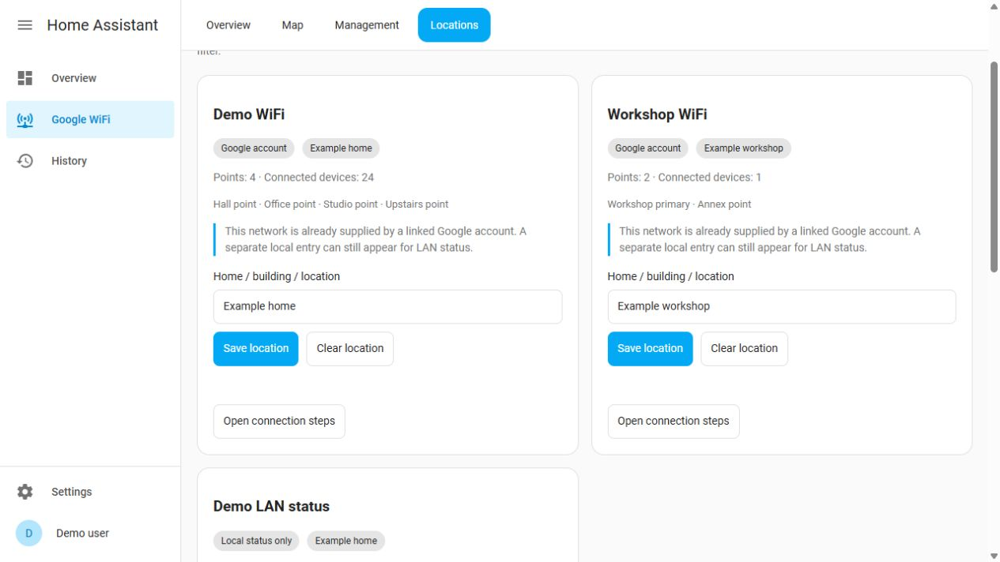
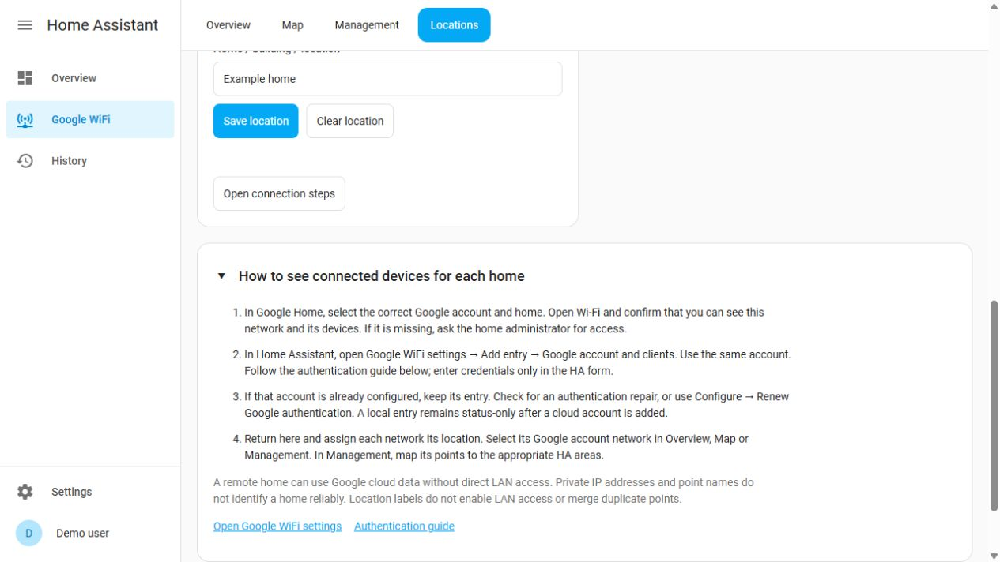

# Homes, buildings and connection setup

Version 0.12.0 adds **Google WiFi → Locations**, a connection guide and a shared
location/network selector for **Overview**, **Map** and **Management**.



## Organize multiple homes

1. Open **Locations**. Each card is an independently discovered Google network or
   an explicitly configured local-status entry. Check its network and point names.
2. Enter a **Home / building / location** name, such as **Example home** or
   **Example workshop**, and select **Save location**. An administrator is required.
3. Reuse a suggested existing name to group several networks under one location.
   Capitalization does not create a different group; spaces are normalized.
4. Use the common location and network selectors above Overview, Map or Management.
   Overview shows one network at a time, preferring an available cloud network when
   **All networks** is selected. Map shows every matching network in its own section.
   Management retains its cloud-network selector for verified actions and mappings.
5. Use **Clear location** to return a network to **No location assigned**.

Locations is always an unfiltered inventory, so an unassigned or previously hidden
network can still be found and relabeled. Labels are shared by users of this HA
instance and survive integration reloads and HA restarts. Names accept up to 64
printable characters. They are included in HA configuration backups.

A location is a local display grouping for an independent network. It is not a
Google Home identifier, a geographic coordinate, a network-access permission or
proof that two points belong together. The integration does not infer a building
from a point name, reused private IP address, SSID or matching location label.
The discovered Google network/config-entry IDs remain the identity boundaries.
Grouping local and cloud entries under one label does not merge duplicate point
records. Existing entity/device IDs, Google names and fixed HA areas stay intact.

Point-to-room associations remain under **Management → Points and areas**. A
single mesh spanning several buildings still has one network location label; use
appropriate HA areas for its individual points. Location labels do not create or
move HA areas or floors. HA's own [areas](https://www.home-assistant.io/docs/organizing/areas/)
and [area registry](https://developers.home-assistant.io/docs/area_registry_index/)
remain authoritative for the existing point mappings.

## Understand local and cloud entries

The old message **Client associations require validation with the Google account**
was shown for a local-status entry with no clients. It did not establish that an
account needed validation. The dashboard now explains the actual limitation and
links to the connection guide.

- **Local status only:** explicitly configured point addresses can provide status,
  firmware and available LAN/WAN information. Their endpoints do not provide this
  integration with a client-to-point inventory. Authenticating a separate Google
  account does not convert or remove the local entry.
- **Google account:** the account supplies independently discovered WiFi groups,
  including accessible remote networks. The location label helps distinguish them.
- **No connected devices reported:** a successful cloud query with zero currently
  connected devices is not, by itself, an authentication failure.
- **Network query unavailable:** the identity/location stays visible, but current
  clients and metrics are unavailable. Check HA's integration error or repair.
  Relabeling a network does not clear that failure or make old measurements live.

Google Home supports separate homes with their own primary WiFi networks; see
[Google's network guidance](https://support.google.com/googlehome/answer/7182840?hl=en-GB).
The Wifi API used here exposes WiFi groups, not a verified building hierarchy.
For this reason, location assignment is explicit rather than presented as an
automatic import of Google Home room/home metadata.

## Connect the correct account for a home

The same steps are available directly in Locations, with links to HA settings
and the [authentication guide](AUTHENTICATION.md).



1. In Google Home, choose the intended account and home. Open **Wi-Fi** and confirm
   that the network and devices are visible. If they are absent, first ask that
   home's administrator for access; a different token cannot grant membership.
2. In HA, open **Settings → Devices & services → Google WiFi Insights → Add entry**
   and choose **Google account and clients** for an account that is not configured.
   Use the same account that can see the home. Follow the authentication guide and
   enter credentials only in HA's form.
3. If the account is already configured, retain its entry. Check for an
   authentication repair, or use **Configure → Renew Google authentication** when
   authentication needs renewal. Do not remove working entries or create another
   local entry to obtain cloud clients.
4. Return to Locations and assign the network's location. Choose that cloud
   network in the dashboard. Map its points to the correct HA areas in Management
   if you want association-based area sensors.

A remote home's Google data does not require direct LAN access from HA. LAN
diagnostics require separately configured, reachable addresses; location labels
do not add hosts, open routes or authorize polling another home's private subnet.
The guidance never asks for tokens in a URL, the dashboard or a chat.

## Service and data model

`google_wifi_insights.set_network_location` accepts a verified **network** entity
from this integration and a required `name` (a printable string, `null` or blank
to clear). It requires a service response and rejects non-administrator user
contexts. Local and cloud networks are supported, including cached networks
during outages. The service saves only local metadata; it does not poll Google,
restart anything, rename devices or enable automatic naming.

```yaml
action: google_wifi_insights.set_network_location
data:
  entity_id: sensor.example_wifi_assessment
  name: Example home
response_variable: saved_location
```

Replace the fictional assessment entity with the selected network's entity.
The response contains `scope` and `location: {id, name}` (or `null`). The group ID
is derived from the normalized label, not from a Google home. It changes when
the label changes and must not be treated as a stable network/device identity.
The network assessment entity exposes `network_location`, `network_location_id`
and `gwi_entry_id` for dashboard routing; no duplicate changing location attributes
are added to every client entity. Cached management also returns `location`.

Each integration entry has a separate local location store keyed by network ID.
Removing that entry removes only its own locations, areas and naming history.
Location names and IDs are omitted from shareable integration diagnostics.
Public screenshots use fictional networks and locally simulated service replies.

## Updating

This feature adds a backend service and persistent metadata. Update the complete
integration to 0.12.0 and restart HA through your usual maintenance process;
copying only the JavaScript files cannot activate location persistence. Until
the new service is present, the page keeps guidance visible and disables label
editing with an explicit update message. Existing configuration entries, area
mappings and naming preferences require no migration or reauthentication.
