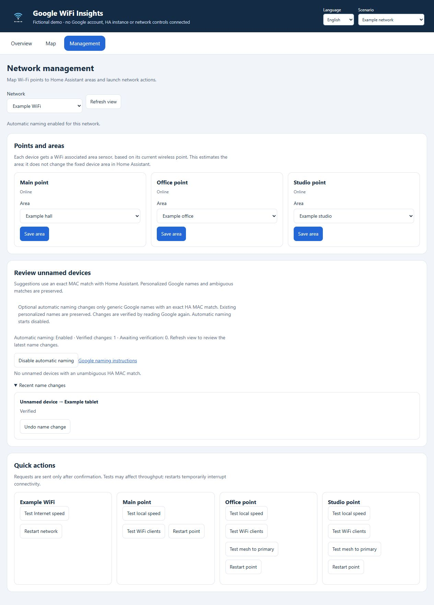

# Automatic Google client names

Version 0.11.0 can replace generic Wi-Fi client names in Google with an agreed
Home Assistant device name. Enable it explicitly for each network in
**Google WiFi → Management**. It starts disabled. Opening Management, configuring
point areas or installing the integration does not enable naming.

This changes the Wi-Fi client label shared with other managers of that Google
network. It does not change a hostname, a Google Home smart-device name, a room,
a fixed HA device area or Wi-Fi association. The separate WiFi associated area
sensor continues to follow the connected point.

## Eligible devices

A suggestion requires all of the following:

- A blank, station-ID, MAC-like or recognized generic Google name, such as
  **Unnamed Device**. Personalized names and ordinary hostnames are preserved.
- One Google station for that MAC in the selected network, and an exact MAC
  match with one agreed HA device name. IP-only and ambiguous matches are skipped.
- A currently connected client, an available cloud network and a name containing
  1–63 characters without control characters. The length restriction is a
  conservative integration limit, not a documented Google API limit.

Use **Apply name in Google** to review and confirm one suggestion.

From version 0.11.1, tick individual suggestions and use **Rename selected**, or
use **Rename all eligible** for the current eligible list. Both are one-time
actions: they do not enable automatic naming or schedule later work. Review the
network, MACs and old/new names in the confirmation before sending. Each request
still uses fresh Google/HA identity checks, a durable intent and verified
read-back through the existing single-device service.

From version 0.14.0, **Simultaneous name requests** in Management accepts **1–10**
per network, with a default of three. An administrator saves the local policy
separately from automatic naming. Each group finishes before the next starts.
Changes apply to the next group, without cancelling or expanding the current
one. These are integration bounds, not a published Google quota. The backend
advertises `rename.max_concurrent` and `concurrency_configurable`. Older backends
keep their advertised limit (or serial dispatch when absent) and show an update
notice instead of a setting they cannot save. The complete backend update needs
an HA restart.

Progress shows verified, in-progress, skipped, review and not-sent counts, plus
individual outcomes in preview order. Concurrent service responses are not merged:
the panel reads the cached management view once after each group finishes.
A changed preview is skipped before dispatch. An unconfirmed or rejected result
stops the remaining queue, with no automatic replay. Pending journal entries
cannot be selected again. Keep Management open until completion; leaving the
view, losing administrator access or losing the network stops further dispatch.
**Stop pending requests** stops further dispatch. Requests already in
progress may still finish and their results remain visible. Check **Recent name
changes** after any uncertain result or closed
browser before starting another batch.

Use **Enable
automatic naming** to confirm ongoing remediation for the selected network.
Automatic work runs after successful normal HA updates, at most once every five
minutes, with at most three candidates across all networks in that config entry
per batch. A slower configured poll interval can delay it further. It does not
force a normal telemetry refresh or run network tests.

The setting survives integration/HA reloads. **Disable automatic naming** works
from the cached management page even during an outage. It prevents subsequent
automatic requests; it cannot recall a request already sent to Google.

## Verification and recovery

Each rename rechecks the current Google name and MAC using fresh Google reads,
then rechecks the HA match against the preview. The sensitive-information lookup
for this check does not rely on the normal MAC cache. The integration saves an
intent record before writing and checks local identity again after that save.
Up to the selected network's configured number of naming operations for different
clients share the config entry's network-action exclusion. Groups do not mix
networks. Requests for the same client remain serialized, as do
intent-storage updates. Each group releases the exclusion before admitting the
next, so a queued restart or network test is not starved. A failed peer prevents
other members of the group that have not yet sent their write from sending it.
An HTTP 429 also applies Google's retry delay to subsequent cloud calls, including
requests waiting for authentication. Sent requests are never recalled or replayed.
Automatic naming remains sequential and keeps its existing three-candidate,
five-minute limit; manual parallelism does not enable it.

The verified request is a `PUT` to
`groups/{groupId}/stations/{stationId}/stationName` with `{"name": "Example phone"}`.
A successful HTTP response, including an empty response, is only an
acknowledgement. A separate fresh Google read must show the same MAC and desired
name before the history, HA label and map are updated as verified.

Failed delivery, failed read-back or a different observed value leaves the result
**Unconfirmed**. An explicit HTTP 4xx refusal of the write is **Rejected**.
Either pauses automatic work for that network. There is no automatic replay,
including after authentication errors or integration reloads. A saved unfinished
intent also pauses the network after reload. A client with a retained,
non-cancelled attempt is skipped by later automatic batches.

The naming transport also intercepts connection loss before aiohttp's built-in
retry of `PUT`/`DELETE`. A request-specific
[client middleware](https://docs.aiohttp.org/en/stable/client_advanced.html#client-middleware)
converts those failures to an unconfirmed result without changing the shared HA
session. Loopback tests close the connection after receiving each write and
assert that the server receives exactly one request.

Use **Verify result** for a fresh read without resending the write. If it confirms
the intended value, the record becomes **Verified**. Review the history before
using **Resume automatic naming**; resuming permits other eligible candidates but
does not replay an uncertain request. If the backend has rejected this feature,
leave automatic naming disabled and use the
[manual Google Home naming workflow](https://support.google.com/googlehome/answer/6346150?hl=en).

**Undo name change** requires the latest request for that client to be a verified
rename, with the current Google name and MAC still matching. It restores the
previous custom name with `PUT`, or restores automatic naming with `DELETE` when
Google identified the old name as automatic. Undo also saves a local exclusion so
automatic batches do not immediately rename that client again. An explicit
manual application is still possible. Undo itself requires read-back verification.

History retains at most 100 records per network, with the most recent 20 returned
to Management. Unconfirmed records are never evicted. Verified/rejected/cancelled
older records can be removed when the limit is reached. Automatic attempt
suppression applies to retained history; explicit undo exclusions persist
separately. There is no request when all record slots contain unresolved intents.

The API does not provide a verified compare-and-set operation for this feature.
Another manager can change a name between our fresh check and write. These checks
reduce that risk but cannot make concurrent edits atomic.

## HA services

All services below return a response and verify the entity's integration,
config entry and network. User contexts must belong to an HA administrator.
Enabling, renaming and undoing additionally require an interactive user context;
an unattended automation cannot enable this feature or apply a manual rename.

| Service | Required fields | Behavior |
| --- | --- | --- |
| `google_wifi_insights.set_name_sync` | `entity_id`, `enabled` | Use any verified entity in the intended network. Enable/resume explicitly; disable also works while the network is unavailable and from HA automations. |
| `google_wifi_insights.set_name_concurrency` | Network `entity_id`, integer `max_concurrent` | Save a local 1–10 limit, default three, for this network. No Google request and no change to automatic naming. Works during outages. |
| `google_wifi_insights.rename_client` | Client `entity_id`, `expected_google_name`, `expected_mac`, `expected_ha_name` | Apply an unchanged proposal returned by `get_management`; no arbitrary replacement name. |
| `google_wifi_insights.verify_name` | Network member `entity_id`, history `request_id` | Fresh read only, scoped to that network. Never repeats a write. |
| `google_wifi_insights.undo_name` | Network member `entity_id`, history `request_id` | Undo the latest verified rename after fresh identity checks. |

The response includes the management view and `name_result` for an individual
operation. `rename.history` contains private intent/verification records;
`rename.provider_state` is `not_tested` before a request. `rename.state` describes
the source of the implemented schema, not proof that the backend accepts it for
your account. Compact `name_sync` status on network diagnostic attributes records
enabled/paused state, concurrency limit and counts, without adding the identity
history to Recorder.

## Privacy

The local HA store `google_wifi_insights.<entry_id>.names` contains network and
station IDs, MAC addresses, matched HA device IDs, original/requested/observed
names, exclusions and verification state. It is included in HA configuration
backups and deleted when that integration entry is removed. It is not a Google
credential store. Authenticated administrator management responses contain this
private data; shareable integration diagnostics omit it. No names or requests
are sent to the project maintainer. Public screenshots and tests use fictional
devices only.

## Request evidence and limits

Google does not publish a supported consumer Google WiFi management API. This
release combines two sources of protocol evidence:

1. The firsthand Android endpoint inventory in
   [google-wifi-api issue 6](https://github.com/olssonm/google-wifi-api/issues/6)
   identifies the REST `PUT` and `DELETE` station-name routes.
2. Static inspection of the archived Google WiFi Android client
   [jetstream-BV10175_RC0005, version code 101750005](https://www.apkmirror.com/apk/google-inc/google-wifi/google-wifi-jetstream-bv10175_rc0005-release/google-wifi-jetstream-bv10175_rc0005-android-apk-download/)
   identifies `UpdateStationNameRequest.name` as its sole serialized string field,
   an empty `UpdateStationNameResponse`, and `Station.automaticFriendlyName` as a
   string. That app references the RPC service
   `google.wirelessaccess.accesspoints.v2.StationsService` with `UpdateStationName`
   and `DeleteStationName`; the REST route comes from the separate inventory.

The archived APK has SHA-256
`d88ddf0bdb079f5d94d9c821dfcd7ac039ac36eb69808dc6a9145f9bf4360b0a`.
Its embedded Google Inc./jetstream certificate fingerprint is
`3a07c097d7502eed47eeef582cc90622aba640667008e71221c5427a9b3368d6`, matching
the fingerprint advertised by the archive. This is provenance metadata, not a
claim of a full independent APK signature verification. The app was neither
installed nor executed. Inspection followed the
[Android DEX format](https://source.android.com/docs/core/runtime/dex-format).
No APK or decompiled Google source is distributed with this integration.

This establishes a historical client schema, **not current backend acceptance**.
Release validation uses an isolated HA, loopback API fixtures and a fictional
browser demo. No new live Google-account rename trial was performed for this
release, and no household HA was changed or restarted. Compatibility remains
beta; actual success is reported only after runtime Google read-back.
