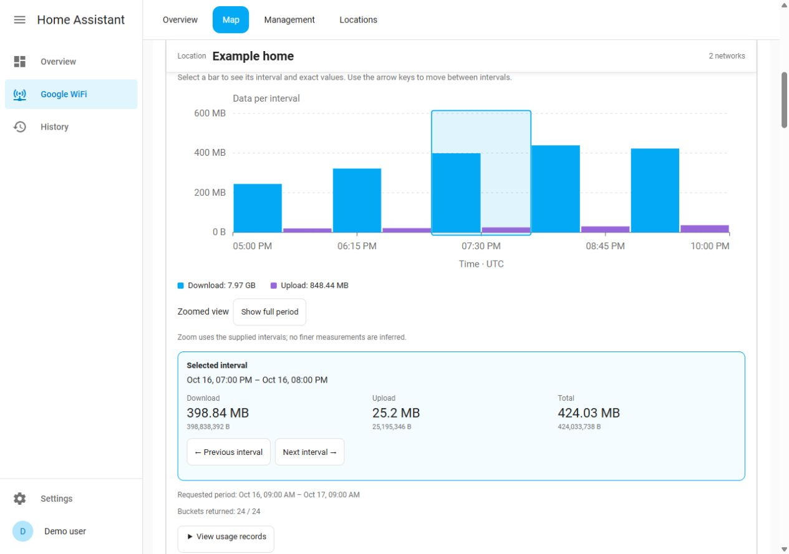

# Usage chart controls

Version 0.14.0 adds labeled byte and time axes to the existing network and client
usage charts in Overview and Map. Dates use Home Assistant's user language and
time zone. The views display the cached records returned by the existing history
service; opening or selecting a chart never starts a network test.

1. Choose **Minute · 1h**, **Hour · 24h**, **Day · 7d** or **Day · 30d**.
2. Select a pair of bars to see its start/end time, download, upload and total.
   Exact byte counts appear below abbreviated values. Zero usage is selectable.
3. Use the arrow keys, **Previous interval** or **Next interval** to move through
   the supplied records. Home/End select the first/last visible interval.
4. **Zoom around this interval** shows up to five existing intervals. It does
   not request a finer measurement or infer minute data from an hourly total.
   **Show full period** restores the complete chart.
5. Expand **View usage records** for the interval table and another way to select
   a record. On narrow screens the chart and table can scroll horizontally inside
   their own containers; the page continues to fit the screen.

Selection, zoom, resolution and record disclosure stay with the entity while the
page is open, including ordinary HA state refreshes. These preferences are held
in browser memory and are separate for each entity. An interval that leaves the
retained history no longer has a selection.

Missing buckets remain gaps. Missing download or upload values remain unknown;
an absent value is not zero and no complete total is shown for that interval.
Totals below the chart cover the supplied records, with partial data labeled.
Zoom changes the visible range while the legend totals still describe the full
requested period. These are traffic volumes, not channel utilization or proof
of Wi-Fi saturation.

On the Map, networks are grouped by their configured location identity. Each
location has a bordered section and a sticky heading; location buttons jump to
the selected home. Networks with identical display names remain separate.
Use the shared location filter when only one home should be visible.
